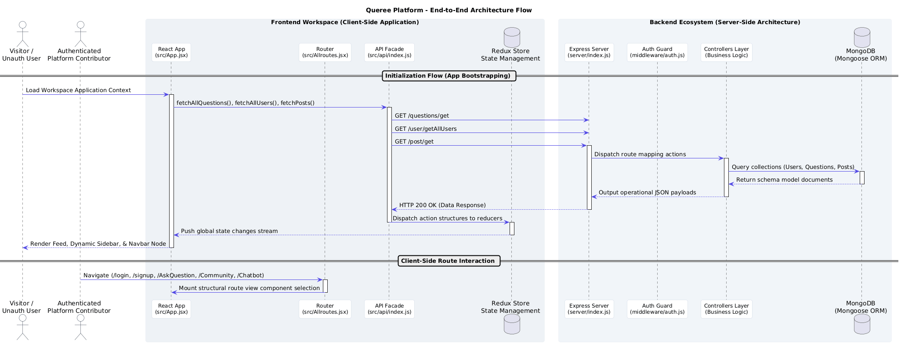

# Queree Platform

Full-stack developer community app with a React frontend and an Express + MongoDB backend.

## Workspaces

- [`frontend/`](./frontend/README.md): Vite + React client for auth, questions, profiles, community posts, subscriptions, and QuereeGPT UI.
- [`server/`](./server/README.md): Express API for auth, data, uploads, subscriptions, OTP mail, and Gemini proxying.

## Core Features

- User signup and login with JWT-based session persistence
- Questions, answers, users, tags, and profile pages
- Community posts with comments, likes, and media upload
- Friend connections and profile image updates
- Razorpay-backed subscription checks and payment flow
- QuereeGPT chatbot access from the app shell

## Sequence Diagram of this project



## Tech Stack

| Layer | Tools |
| :--- | :--- |
| Frontend | React 19, Vite, React Router DOM, Redux, Tailwind CSS, Axios, Playwright |
| Backend | Node.js, Express, MongoDB, Mongoose, JWT, bcryptjs, Nodemailer, Cloudinary, Razorpay, `@google/genai` |

## Repository Layout

```text
.
|-- frontend/
|-- images/
|-- server/
`-- README.md
```

## Local Setup

Install and run each workspace separately.

```bash
cd server
npm install
npm run start
```

In a second terminal:

```bash
cd frontend
npm install
npm run dev
```

## Environment Summary

- Frontend may use `VITE_CLOUDINARY_CLOUD_NAME` and `VITE_CLOUDINARY_UPLOAD_PRESET`.
- Server requires MongoDB and JWT configuration, and optionally uses Cloudinary, SMTP, Razorpay, and Gemini settings.
- See the workspace READMEs for the complete env variable lists.

## Current Notes

- The chatbot route is `POST /chat/add`.
- The frontend includes a forgot-password flow, but the current server route set does not yet expose password-reset endpoints.